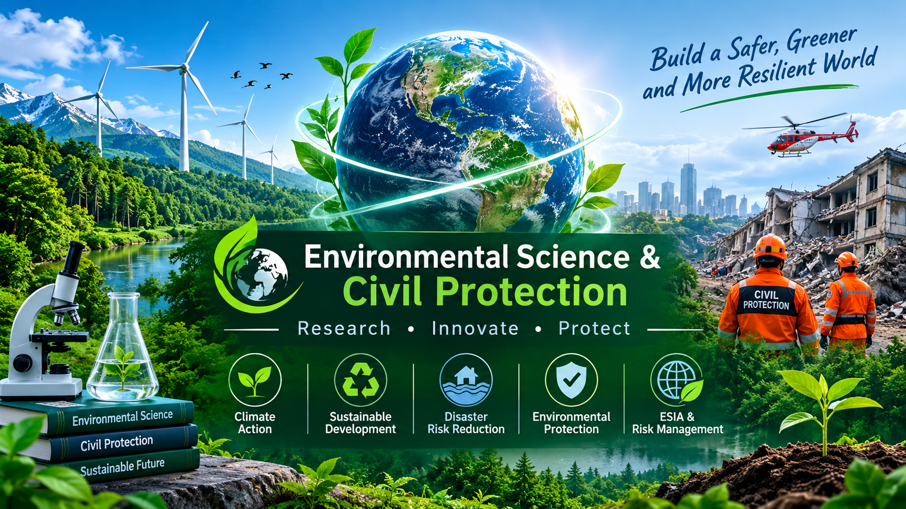

  

<h1 align="center">MD YASIN 🌿</h1>

<h3 align="center">
Computer Science & Engineering Student
</h3>

Environmental Science & Civil Protection

Aspiring Environmental & Social Impact Assessment
(ESIA) Specialist | Bangladesh

Protecting Nature | Promoting Sustainability |
Supporting Responsible Development

---

## 🌍 About Me

Hello! I am MD Yasin, an Environmental Science and
Civil Protection student interested in environmental
sustainability, environmental assessment, and
social impact studies.

My long-term goal is to become an Environmental
and Social Impact Assessment (ESIA) Specialist
in Bangladesh.

I am passionate about environmental protection,
sustainable development, and responsible
project assessment.

## 🎯 Career Interests

- Environmental and Social Impact Assessment (ESIA)
- Environmental Impact Assessment (EIA)
- Environmental Management and Monitoring
- Climate Change and Sustainability
- Biodiversity Conservation
- Pollution Control and Waste Management

## 🔬 Research & Project Interests

- Water Quality Assessment
- Environmental Pollution Analysis
- Environmental Risk Assessment
- Ecosystem Protection
- Sustainable Development

## 💻 Technical Skills

- Environmental Research
- Data Analysis
- Microsoft Excel
- Java Programming
- Git & GitHub

## 📂 Featured Projects

My academic and research-based projects
will be showcased here.

## 🎓 Education

### 📘 Current Education
**Bachelor of Science in Computer Science and Engineering (CSE)**

Hamdard University Bangladesh

Currently pursuing my undergraduate studies.

### 🌍 Intended Higher Studies
**Bachelor's in Environmental Science and Civil Protection**

Università Politecnica delle Marche (UNIVPM), Italy

Aspiring to pursue higher education in Environmental
Science and Civil Protection, with a strong interest
in environmental sustainability, impact assessment,
and sustainable development.

## 🇧🇩 My Vision

My vision is to return to Bangladesh and
contribute to environmental protection and
sustainable development as an Environmental & Social Impact assessment (ESIA) Specialist.

---

🌱 A Sustainable Future for Bangladesh

